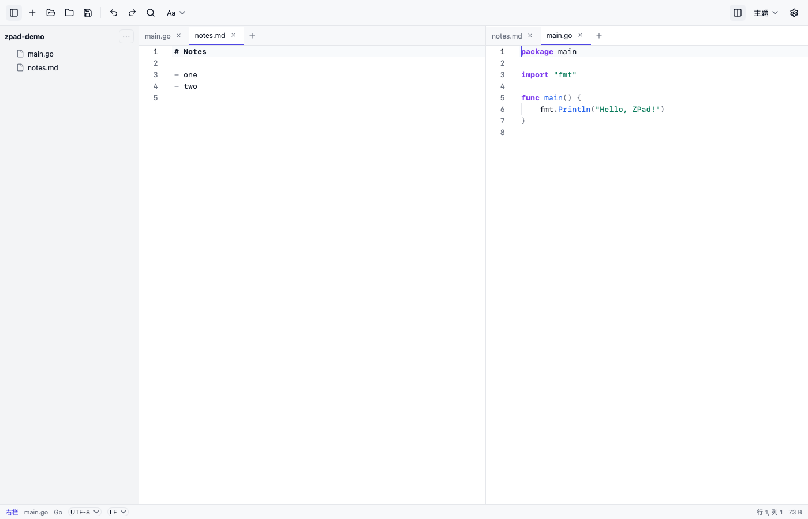
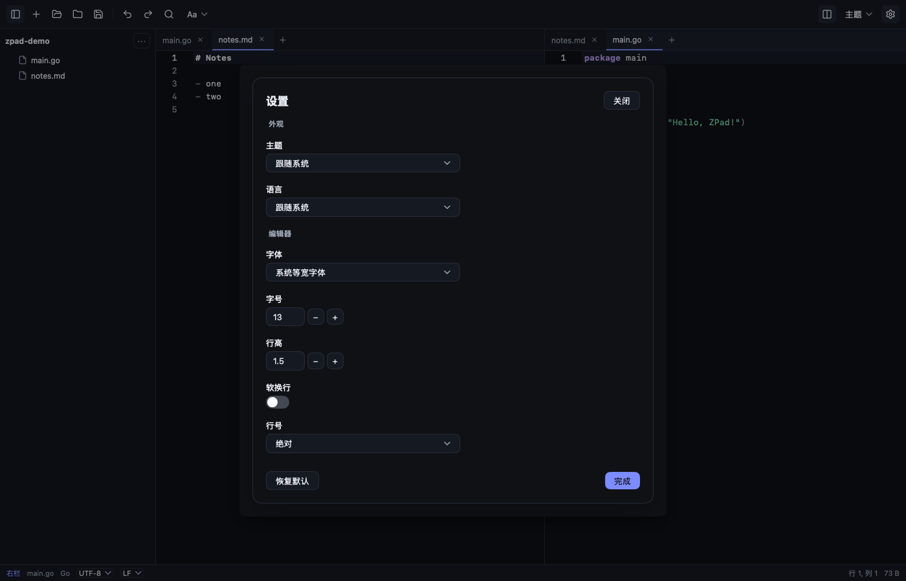

# ZPad

基于 [MyGo](https://mygo.run/) 原生 UI 的轻量级文本 / 代码编辑器。
单窗口、左右或上下双栏、每栏多标签，不启动 WebView，界面全部由 Go 绘制。

当前进度：**0.3.2 平台快捷键提示**。功能、设置、双语、分屏、会话、打包与自动更新均已完成；0.3.1 已发布，0.3.2 待发布。

## 截图

| 亮色 | 暗色 |
| --- | --- |
|  |  |



## 环境

- Go **1.27.4**（官网 tarball 安装，`/usr/local/go`）
- macOS（一期只验收 macOS；Windows / Linux 后续适配）
- 原生 UI 无需 Bun、Node、WebView

## 开发

```sh
go tool mygo dev     # 启动开发版，改 .go 文件自动重启
go test ./...        # 不打开窗口的视图测试与单元测试
go tool mygo build   # 打包 macOS 应用
```

首次运行 `go tool mygo dev` 时，Go 会按 `go.mod` 准备 MyGo CLI 与依赖。

## 目录

```
.
├── main.go                 # 应用入口：设置、窗口、主题源、更新插件
├── fonts.go                # 嵌入并注册 JetBrains Mono
├── fonts/                  # JetBrains Mono TTF + OFL
├── mygo.json               # 应用名称 / 标识 / 版本 / 文件关联
├── go.mod                  # Go 1.27.4 + MyGo v0.10.0
├── docs/                   # 需求、里程碑、截图
├── locales/                # 中英文 catalogs + 生成代码
├── resources/              # 应用图标与字体许可
└── internal/
    ├── app/                # 应用状态、文档、标签、视图、菜单
    ├── atomicfile/         # 原子写文件
    ├── caseconv/           # 大小写转换
    ├── encoding/           # 编码检测 / 解码 / 编码
    ├── files/              # 工作区目录树
    ├── session/            # 会话读写（M2 接入）
    ├── settings/           # 设置模型与持久化
    └── theme/              # 亮色 / 暗色调色板与编辑器主题
```

## 文档

- [需求与里程碑索引](./docs/README.md)
- [最终需求](./docs/00-requirements.md)
- [M0 项目骨架](./docs/01-m0-skeleton.md)
- [M1 单栏编辑闭环](./docs/02-m1-editor-core.md)
- [M2 左右双栏与会话恢复](./docs/03-m2-split-session.md)
- [M3 视觉、设置、字体与中英双语](./docs/04-m3-appearance-settings.md)
- [M4 加固、文件关联与 macOS 发布](./docs/05-m4-hardening-release.md)
- [自动更新](./docs/06-auto-update.md)
- [CHANGELOG](./CHANGELOG.md)

## 快捷键

| 快捷键 | 动作 |
| --- | --- |
| `Cmd+N` | 新建文件 |
| `Cmd+O` | 打开文件 |
| `Cmd+Shift+O` | 打开文件夹 |
| `Cmd+S` | 保存 |
| `Cmd+Shift+S` | 另存为 |
| `Cmd+W` | 关闭标签 |
| `Cmd+B` | 切换侧栏 |
| `Cmd+\` | 切换分屏 |
| `Cmd+Shift+B` | 在浏览器中打开（HTML） |
| `Cmd+Shift+V` | Markdown 源码 / 预览 |
| `Cmd+,` | 设置 |
| `Cmd+F` / `Cmd+Alt+F` | 查找 / 替换 |
| `Ctrl+G` | 跳转到行 |
| `Cmd+Z` / `Cmd+Shift+Z` | 撤销 / 重做 |

## 已实现

- 打开文件、打开文件夹、新建文件、拖拽打开。
- 侧栏双 Tab：打开的文件（只显示文件名，悬停浮出完整路径以区分同名文件）与工作区文件树（默认关闭，打开文件夹时展开，单击打开 / 展开），隐藏文件开关、刷新。
- 文件树右键菜单：在副窗口打开、重命名、删除；重命名会同步已打开标签的路径，删除前检查未保存修改。
- 「打开的文件」列表对已保存文件也提供在副窗口打开 / 重命名 / 删除。
- 多标签、未保存圆点、关闭标签提示。
- 语法高亮、行号、多光标、折叠、查找替换、跳转行。
- 保存 / 另存为，原子写入。
- UTF-8 / UTF-8 BOM / UTF-16 LE/BE / GB18030 检测与切换。
- LF / CRLF / CR 显示与转换。
- 大小写转换（大写、小写、首字母大写、反转，多选区）。
- 亮色 / 暗色 / 跟随系统，编辑器 token 配色。
- 状态栏：路径（旁有「在文件管理器中显示」）、语言（HTML 旁有浏览器打开，Markdown 旁有预览切换）、编码、换行、行列、选区、大小、未保存标记。
- Markdown 原生预览：标签内切换源码 / 预览，分屏可源码 + 预览；GFM 表格、任务列表、脚注、代码高亮、本地图片和链接；原始 HTML、MDX、远程图片不渲染。
- 原生菜单与快捷键。
- 左右 / 上下双栏：每栏独立标签，同一文件跨栏共享 Buffer，活动栏跟随焦点；标签可拖到另一栏，分屏默认按内容区 50/50 拆开，某栏最后一个标签关闭后自动收起分屏。工具栏分屏按钮下拉选择方向，两个方向分别记住分隔位置。
- 会话恢复：工作区、分屏、宽度、标签、活动标签、滚动位置、侧栏（默认关闭，可在设置中开启）。
- 关闭 / 退出未保存汇总：保存全部 / 不保存 / 取消。
- 完整设置面板：主题、语言、字体、字号、行高、换行、行号、缩进、文件默认值、工作区。
- 内置 JetBrains Mono（OFL），字体列表只列等宽字体。
- 中英双语，运行期切换，无需重启。
- 查找栏、跳行栏、滚动条与焦点环统一风格。
- 大文件只读打开（按设置阈值或 50 万行）；二进制文件拒绝。
- 外部修改检测：窗口聚焦时比较 mtime / size，未修改自动重载，有修改时选择重载 / 保留 / 另存为。
- 文件关联：文本 / 数据 / 源码共 86 个扩展名；支持 Finder、拖拽、命令行打开。
- 文件保存失败、只读目录、文件被删除等错误处理。
- 自动更新：从 GitHub Releases 检查新版本，原生窗口显示发布说明并安装；更新包用 Ed25519 签名校验，支持增量下载。菜单「ZPad / 帮助 → 检查更新…」可手动检查。

## macOS 发布

```sh
go tool mygo build
```

产物沿用 `mygo build` 的默认命名，不再重命名（CI 用 `-upload` 直接上传）：

- `zpad-0.3.2-arm64.dmg`、`zpad-0.3.2-amd64.dmg`
- `zpad-setup-0.3.2-amd64.exe`
- `zpad-0.3.2-windows-amd64-portable.zip`（CI 额外打的 Windows 绿色版）

自动更新的文件由 `mygo build` 生成，**不能改名**（manifest 里写死了 URL）：

- `zpad-0.3.2-darwin-arm64.tar.gz`、`zpad-0.3.2-darwin-amd64.tar.gz`、`zpad-0.3.2-windows-amd64.tar.gz`
- 增量包 `zpad-<旧版本>-to-0.3.2-<平台>.delta`
- 清单 `update-darwin-arm64.json`、`update-darwin-amd64.json`、`update-windows-amd64.json`

发布构建需要 `MYGO_UPDATER_PRIVATE_KEY`（`mygo keygen` 生成的 `mygo-update.key`，同时作为仓库 secret）。`mygo build -upload` 会先上传安装包与 `.tar.gz` / `.delta`，最后上传 manifest；在 GitHub 上把 draft 发布为 **latest**（不要勾 pre-release）。详细流程见 [docs/06-auto-update.md](./docs/06-auto-update.md)。

`mygo.json` 已声明 `fileAssociations`：`Text Document`（txt / md / html / css / json / yaml / xml / diff 等）与 `Source Code`（go / py / rs / js / ts / c / cpp / java / rb / php / lua / sh / sql / vue / svelte 等），共 86 个扩展名。构建后 Finder 双击对应文件可用 ZPad 打开；如系统未立即刷新关联，可重新登录或清理 LaunchServices 缓存。macOS 的 `CFBundleDocumentTypes` 由 MyGo 写入 `LSHandlerRank: Default`，与系统已有默认程序冲突时以用户选择为准。

当前构建未签名、未公证。首次打开可能被 Gatekeeper 拦截：右键应用选择“打开”，或在系统设置中允许。正式分发需要 Apple Developer 账号并完成签名 / 公证。自更新不依赖 Apple 签名（更新包由 Ed25519 验签），但 ad-hoc 签名每次构建都会变化，更新后 macOS 可能要求重新授予文件访问等权限。

## 当前限制

- 全局搜索在二期；外部修改只做窗口聚焦时的 mtime 检查，不含完整监听与三方合并。
- Markdown 预览上限约 1 MB / 1 万行；预览内查找、滚动同步、目录 / TOC、MDX、远程图片、frontmatter 和数学 / Mermaid 渲染未做；预览模式不写入会话，重启后按源码恢复；宽表格在窄栏内横向滚动（单列上限约 600px）。
- 自动更新：0.3.0 是第一个带更新器的版本，它自己收不到更新，0.3.1 起可自更新；开发版（`mygo dev` / `go run`）不能更新。标准用户需把应用装在 `~/Applications`（`/Applications` 需要管理员权限），从只读 DMG 直接运行也无法自更新。
- 标签中键关闭、拖拽排序未实现。
- 设置修改立即写盘，未做防抖。
- 超过 50 万行的文件只读；大文件不参与会话恢复的完整滚动精度。
- Windows / Linux 打包后续处理；单实例与命令行参数转发已实现，Windows 上「默认应用」需用户手动选择。

## 许可证

- 应用：AGPL-3.0，见 [LICENSE](./LICENSE)。
- 内置字体 JetBrains Mono：SIL Open Font License 1.1，见 [fonts/OFL.txt](./fonts/OFL.txt)。
