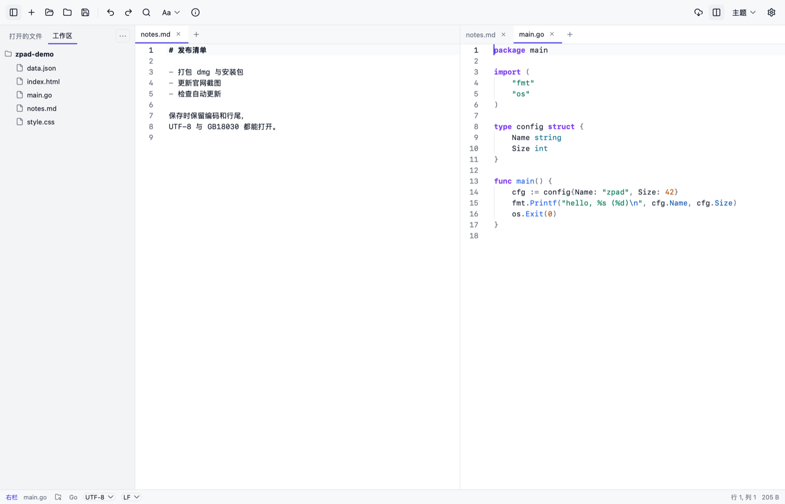
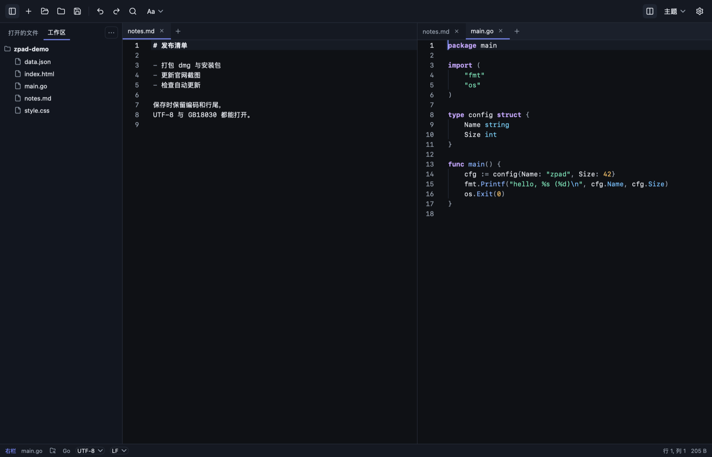
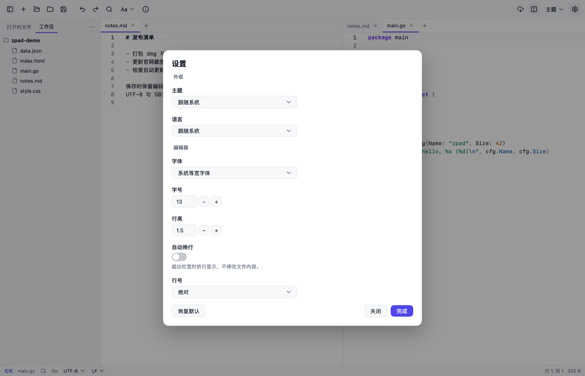
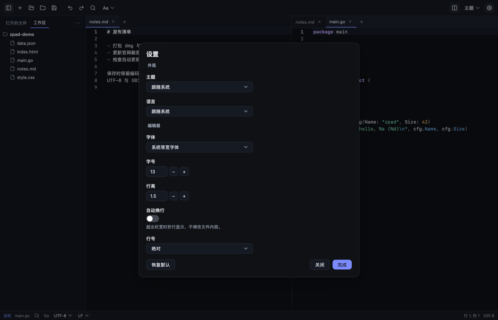

# ZPad

ZPad 是一款轻量、原生、纯粹的文本编辑器，基于 [MyGo](https://mygo.run/) 框架进行开发，没有插件、没有云同步、没有 Git、没有 AI、没有 WebView。

## 功能特点

- 支持打开整个项目，文件树随点随开
- 支持常见文本格式：txt、md、css、js、json、yaml、yml、html、conf、toml、go、py、php 等
- 原生渲染，不使用 WebView，启动快、内存占用更低
- 跨平台：目前已支持 macOS 和 Windows，随后支持 Linux
- 支持左右、上下分屏查看与编辑
- 支持一键在线更新
- 支持 Markdown 原生预览
- 支持暗色、亮色两种模式
- 支持中文、英文双语切换
- 内置基础文本工具：查找、替换、大小写转换等

## 截图

| 亮色 | 暗色 |
| --- | --- |
|  |  |

| 设置（亮色） | 设置（暗色） |
| --- | --- |
|  |  |

## 联系

- 博客：<https://blog.xiaoz.org/>
- X：<https://x.com/xiaozblog>
